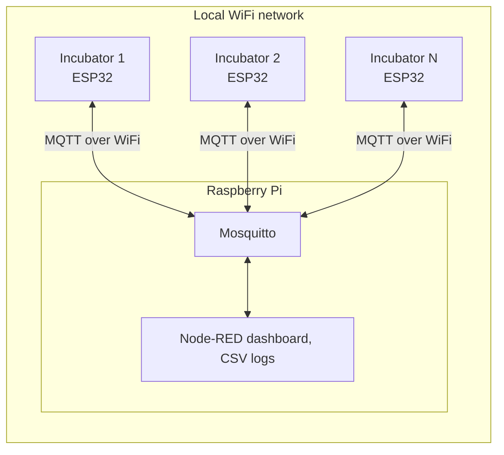

# OpenPlant Incubator Firmware

Firmware and gateway setup for the OpenPlant plant incubator: a temperature- and light-controlled growth chamber run by an ESP32.

The project is designed to scale. Each incubator runs the same firmware, and a fleet of them can be monitored and controlled from one dashboard.

## Design goals

OpenPlant is a community project. Developer time comes and goes, and future maintainers may not be technical. So the system aims to be:

- **Very stable:** set it and forget it.
- **Low maintenance:** standard, well-supported software instead of custom code.
- **Easy to follow:** anyone can operate and repair it using written instructions.

## Scope

Each incubator is a self-contained unit controlled by its own **ESP32 running the Arduino firmware** in `incubtaorPwmControl/`, which handles all **local control**:

- Reading temperature and humidity
- Driving the Peltier cooling unit and the inside circulation fans
- Setting the grow-light intensity
- Taking input from the on-device buttons and showing status on the OLED

The incubator does not depend on the network. If WiFi or the gateway goes down, it keeps controlling to its set point, and the buttons keep working.

Multiple incubators are joined together by a **Raspberry Pi gateway** running **Mosquitto** (MQTT broker) and **Node-RED** with FlowFuse Dashboard 2.0:

- Each incubator connects to the broker and publishes its readings under its own topic, so new incubators show up on the dashboard without changes.
- The dashboard shows each incubator's temperature, humidity, set point, light level, fan speeds and cooling state, with 24 hours of history, and logs readings to CSV.
- From the dashboard you can **control** each incubator's temperature set point and light intensity. Changes made on the dashboard and with the buttons stay in sync.

## Architecture



## MQTT topics

Each incubator names itself `inc-<last 6 hex digits of its MAC>`, for example `inc-9d081c`, so every unit runs the same binary.

| Topic | Direction | Retained | Payload |
|---|---|---|---|
| `openplant/incubator/<id>/status` | ESP → Pi | Yes | `online`, or `offline` (set by the broker as last will) |
| `openplant/incubator/<id>/meta` | ESP → Pi | Yes | `{"id","fw","mac","ip"}` |
| `openplant/incubator/<id>/state` | ESP → Pi | No | `{"temp","humidity","fan1_rpm","fan2_rpm","light","setpoint","cooling","rssi","uptime"}`, every 30 s and immediately when set point, light or cooling changes |
| `openplant/incubator/<id>/cmd/setpoint` | Pi → ESP | No | Whole degrees, 18–26 |
| `openplant/incubator/<id>/cmd/light` | Pi → ESP | No | `32`, `64`, `96` or `128` |

## Incubator hardware

| Part | ESP32 pin(s) | Purpose |
|---|---|---|
| Adafruit Feather ESP32 (`featheresp32`) | — | Main controller |
| AHT10/AHT20 temperature/humidity sensor | I2C (SDA 23, SCL 22) | Climate sensing (SHTC3 support: #3) |
| SH1107 128×64 OLED FeatherWing (0x3C) | I2C | Status display |
| Grow light | 5 | PWM brightness |
| Inside circulation fans ×2 | 18, 19 (PWM), 21, 4/A5 (tach) | 25 kHz PWM, RPM feedback |
| Cooling unit (Peltier + outside fan) | 27, 33 | On/off |
| Button A / B / C on the OLED wing | 32 / 15 / 14 | Set point up / set point down / light level |

## How local control works

Cooling only: there is no heating element. Every 5 seconds the firmware compares the temperature with the set point:

| Condition | Cooler | Inside fans |
|---|---|---|
| Above set point + 0.5 °C | On | 100% |
| Below set point − 0.5 °C | Fans drop to 0% first, then the cooler turns off on the next check | 0% |
| Within ± 0.5 °C | Unchanged | 50% |

- The set point defaults to 22 °C at power-up and can be set between 18 and 26 °C. The buttons change it by 1 °C and wrap around at the ends of the range.
- The light button steps through 32 → 64 → 96 → 128 (default 64).
- The OLED shows temperature, humidity, light level, fan RPMs, a status marker (`+` cooling, `-` below range, `o` in range) and the device ID with WiFi/MQTT connection state.

## Getting started

### Flash an incubator

The firmware builds with the Arduino IDE using ESP32 Arduino core **2.x** (core 3.x removed the `ledcSetup` API it uses) and the Adafruit GFX, SH110X and AHTX0 libraries, plus PubSubClient.

1. Copy `incubtaorPwmControl/secrets.h.example` to `secrets.h` and fill in the WiFi and MQTT broker details. `secrets.h` is git-ignored.
2. Open `incubtaorPwmControl/incubtaorPwmControl.ino`, select the Adafruit ESP32 Feather board and upload.

### Set up the dashboard

On the Pi, import `raspi_mqtt/openplant_dashboard_flow.json` into Node-RED (**☰ → Import**) and deploy. The dashboard is at `http://<pi>:1880/dashboard/incubators`. It reuses an existing MQTT broker config (`broker-pi`) and Dashboard 2.0 base (`ui-base-1`); on a fresh Node-RED install, set those on the imported nodes. CSV logs go to `/home/cybermat/openplant/<id>_<date>.csv` (change `LOG_DIR` on the flow tab).

`raspi_mqtt/raspi_node_red_flow.txt` is the older flow for incubators on the previous `incubator/...` topic schema.

## Repository layout

```
.
├── incubtaorPwmControl/           Incubator firmware (Arduino)
├── raspi_mqtt/                    Node-RED flows for the Pi gateway
└── ESP32-mqtt-client/             Early MQTT prototype (no longer needed)
```

## Contributing

Every change follows the workflow in [`CLAUDE.md`](CLAUDE.md): create an issue, open a PR that links it with `Closes #N`, and merge the PR to close the issue.
